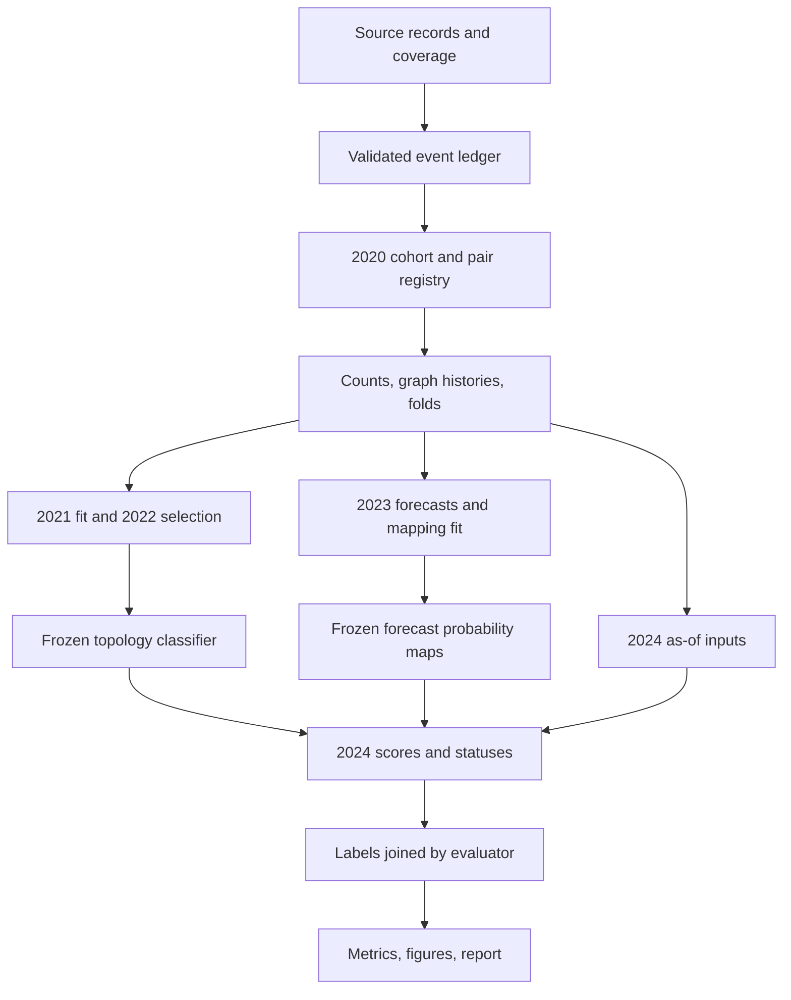

# 02. Architecture and interfaces

## System shape

Build one Python package and a local command-line pipeline. Keep scientific transforms pure and move network calls, file writes, process management, and model initialization to explicit boundaries. This project is small enough to run on one machine; distribution and a database server add failure modes without helping the research question.

The default runtime is Python 3.11. Resolve and lock compatible versions during bootstrap instead of treating the version ranges in the red starter as a research lock. Use DuckDB for local tabular queries, Parquet for persisted tables, NumPy for numerical arrays, scikit-learn for supervised fitting, statsmodels for ARIMA, Prophet for its baseline, and PyTorch plus the official Timestral package for foundation-model inference. Use pandas at library boundaries that need DataFrames. NetworkX may be used for the small graph if it improves clarity; a tested adjacency-set implementation is also sufficient. Use matplotlib for exportable plots. These are project choices, not claims that this handoff has installed or benchmarked every dependency.

## Data and dependency flow

The main execution has two independent sources of fitted artifacts that meet only during final evaluation:



The forecast adapter receives only histories, identities, dates, and inference configuration. The evaluator owns the future-label table. Store labels separately from model inputs; joining them for metrics happens after predictions are persisted. The static classifier's supervised fitting stage is the exception that intentionally consumes its designated historical training labels.

## Module boundaries

| Module | Responsibility | Must not do |
| --- | --- | --- |
| `domain.py` | Typed events, pairs, folds, metrics, explicit errors | File I/O or model loading |
| `ingestion.py` | Normalize rows and deduplicate immutable event IDs | Fit models or silently repair lost event-code digits |
| `sources/` | Local readers, optional BigQuery/export/download adapters | Infer missing coverage from absence of rows |
| `registry.py` | Versioned country-code validation and metadata | Choose countries using later outcomes |
| `universe.py` | Cohort selection, all-pairs enumeration, key equality | Filter to historically positive pairs |
| `temporal.py` | Calendars, count windows, labels, persistence, chronology guards | Use local-machine timezone for event bins |
| `graph.py` | Rolling graph snapshots and pair metrics | Add outside-cohort neighbors |
| `features.py` | Build aligned, causal `(B,90)` / `(B,2,90)` arrays | Join realized future features |
| `models/base.py` | Typed adapter protocol and validation | Load all optional backends on import |
| `models/timestral.py` | Genuine cached foundation-model loading/inference | Substitute another checkpoint silently |
| `models/classical.py` | ARIMA/Prophet rolling-context fits and declared constant rule | Tune against future labels |
| `models/direct.py` | Simple ranking baselines | Pretend raw scores are probabilities |
| `models/logistic.py` | Topology classifier and forecast mapping pipelines | Fit scalers on held-out test data |
| `metrics.py` | Per-origin metric definitions and support counts | Random tie-breaks or missing-model row deletion |
| `evaluation.py` | Prediction/label joins, macro summaries, paired comparisons | Choose final configuration using test performance |
| `artifacts.py` | Schemas, hashes, atomic writes, cache keys, run manifests | Overwrite a mismatched previous run |
| `pipeline.py` | Stage orchestration, task state, recovery, budgets | Contain scientific formulas duplicated from core modules |
| `reporting.py` | Tables, figures, Markdown/HTML report from outputs | Invent claims, recalculate a different experiment |
| `cli.py` | Validate user arguments and call pipeline stages | Hide exceptions behind success exit codes |

The starter already fixes small public APIs for ingestion, universe, temporal, graph, and metrics. Preserve those contracts while adding scalable array/DataFrame internals. The project is not required to call a Python loop for every event in a five-year dataset. Compare vectorized implementations with the small pure APIs on fixtures.

## Adapter protocol to implement

Use this semantic interface; concrete typed dataclasses are an implementation task:

```python
class ForecastAdapter(Protocol):
    model_id: str

    def predict(self, batch: HistoryBatch) -> ForecastBatch:
        """No labels in HistoryBatch. One 30-vector per ordered batch pair."""

class HistoryBatch:
    origin: date
    pairs: tuple[Pair, ...]
    context_dates: tuple[date, ...]  # length 90
    counts: NDArray                 # (B, 90), float32 at model boundary
    past_graph: NDArray             # (B, 2, 90), Jaccard then PA
    input_hash: str

class ForecastBatch:
    pairs: tuple[Pair, ...]
    origin: date
    raw_point: tuple[NDArray | None, ...]  # B rows, each success shape (30,)
    features: tuple[NDArray | None, ...]   # B rows, each success finite/nonnegative
    statuses: tuple[str, ...]       # ok / constant_series / failed
    provenance: Mapping[str, object]
```

The Timestral adapter adds the singleton target-variate axis internally. Do not flatten the batch axis into time or pass graph features as future-known covariates. Any output mismatch is an adapter error before probability fitting. Failed rows carry `None` forecasts and an error/status record, never a fabricated zero vector. Successful rows can be stacked into arrays; preserve the complete original pair identities/status inventory. A required calibration panel must be wholly successful before fitting its mapper, so error records cannot become permission to train on a reduced favorable subset.

## Persisted layout

```text
data/input/                 user export and its coverage/provenance
data/registry/              source lookup, reviewed allowlist, cohort
data/normalized/            event ledger and rejection summaries
data/derived/               counts, features, fold manifests
artifacts/forecasts/        model/origin forecast caches
artifacts/fitted/           topology classifier and four forecast mappers
runs/<run_id>/              config, environment, hashes, task states, logs
outputs/<run_id>/           predictions, metrics, comparisons, figures, report
```

Never commit raw five-year data, model weights, credentials, `.venv`, or regenerable bulk caches. Small synthetic fixtures, specifications, tests, code, query templates, and environment locks belong in Git. Publish nothing automatically.

## Caching and identity

Cache identity includes schema version, model ID, complete source and checkpoint revisions, normalized input-content hash, cohort hash, candidate order, origin, history date bounds, graph definition, inference dtype/device class and settings, and feature-schema hash. Mapping caches additionally include fit-row IDs, fit labels, class counts, scaler specification, regularization, and optimizer configuration. A global cache may contain many origins, but its keys must not allow a changed historical event to reuse old forecasts.

Derive `run_id` from a readable timestamp plus configuration/content digest; record the exact full digest in the manifest. Write a temporary file, validate it, then atomically rename it to its final path. A completed checkpoint is reusable only after its expected output/hash/schema matches. Partial writes remain incomplete.

## Error and completion model

Use explicit errors for malformed data, missing coverage, chronology violations, incompatible schemas, dependency absence, and backend failure. Exclusions such as a legitimate non-061 row are counted separately from malformed input. Do not catch `Exception` and return zeros.

`completion.json` separates these booleans:

- `engineering_complete`: required implemented commands and all relevant tests pass.
- `demo_complete`: the synthetic end-to-end pipeline and report succeed offline.
- `research_complete`: the fixed real-data experiment, all models, all required final windows and reports satisfy the scientific gate.

An engineering-complete pipeline can have research blocked by missing credentials or data. A valid experiment can have a negative result. These states are distinct and must remain visible.

## Minimal output interface

Implement `cooperalink doctor`, `validate-input`, `prepare`, `demo`, `fit`, `evaluate`, `report`, `run`, and `resume` as specified in the runbook. The CLI should emit readable progress plus machine-readable stage state. Reports are local files; a separate web backend or application is unnecessary. A read-only viewer may be added after the scientific acceptance gates, but does not replace them.
