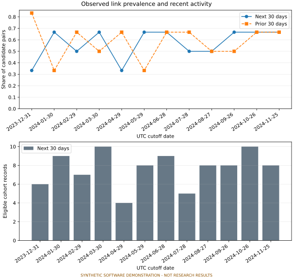
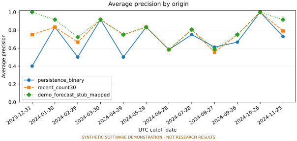
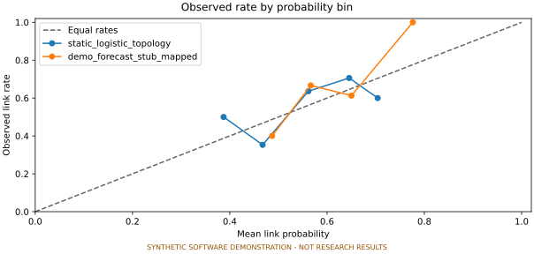

# Forecasting International Economic Cooperation Links in Temporal Event Networks Using GDELT and Timestral

**SYNTHETIC SOFTWARE DEMONSTRATION - NOT RESEARCH RESULTS**

Urvi Desai, Sinchana Arun, and Varesh Patel

Rutgers course project. Recorded 2026-11-20. Run demo_multiyear.

## Abstract

This offline report verifies the data-to-metrics workflow with synthetic inputs.

## Problem definition

An economic-cooperation link is at least one distinct GDELT 2.0 event ID with exact CAMEO 061 for an unordered pair during UTC days T+1 through T+30. The endpoints are actor-country affiliations. Observations enter the history on their UTC DATEADDED day, with SQLDATE retained for audit.

A negative is a candidate pair with zero qualifying records in a fully covered target window. Every selected pair is retained, including pairs with no previous record. Missing extraction coverage invalidates the affected origin.

## Data and coverage

The offline fixture exercises 6 synthetic candidate pairs.

| country_code | incidence | rank | selection_year | selected | synthetic |
| --- | --- | --- | --- | --- | --- |
| AUS | — | 1 | — | True | True |
| CAN | — | 2 | — | True | True |
| IND | — | 3 | — | True | True |
| USA | — | 4 | — | True | True |

| Cleaning audit | Observed value |
| --- | --- |
| cohort_retained | 455 |
| cohort_retained_share | 1.0 |
| duplicate | 0 |
| eligible_unique | 455 |
| source_rows | 455 |

| Origin | Candidates | Positives | Negatives | Positive prevalence | Active last 30 days | Eligible cohort records | Extraction coverage |
| --- | --- | --- | --- | --- | --- | --- | --- |
| 2023-12-31 | 6 | 2 | 4 | 0.3333 | 0.8333 | 6 | complete |
| 2024-01-30 | 6 | 4 | 2 | 0.6667 | 0.3333 | 9 | complete |
| 2024-02-29 | 6 | 3 | 3 | 0.5000 | 0.6667 | 7 | complete |
| 2024-03-30 | 6 | 4 | 2 | 0.6667 | 0.5000 | 10 | complete |
| 2024-04-29 | 6 | 2 | 4 | 0.3333 | 0.6667 | 4 | complete |
| 2024-05-29 | 6 | 4 | 2 | 0.6667 | 0.3333 | 8 | complete |
| 2024-06-28 | 6 | 4 | 2 | 0.6667 | 0.6667 | 9 | complete |
| 2024-07-28 | 6 | 3 | 3 | 0.5000 | 0.6667 | 5 | complete |
| 2024-08-27 | 6 | 3 | 3 | 0.5000 | 0.5000 | 8 | complete |
| 2024-09-26 | 6 | 4 | 2 | 0.6667 | 0.5000 | 8 | complete |
| 2024-10-26 | 6 | 4 | 2 | 0.6667 | 0.6667 | 10 | complete |
| 2024-11-25 | 6 | 4 | 2 | 0.6667 | 0.6667 | 8 | complete |



## Methods and temporal protocol

A rolling 30-day graph includes an edge for any recorded pair activity by each day's cutoff. Timestral-209M uses 90 daily count rows and, for the graph variant, historical Jaccard and preferential attachment. Graph aggregation extends raw input support to 119 days. The count-only variant uses 90 days of counts. Its comparison with the enriched variant reflects both topology and the larger effective raw history.

2020 establishes the cohort. The topology logistic scaler and classifier train on 2021, select regularization by 2022 macro AP, and refit on both years. Four separate forecast-to-link logistic heads train on 2023 only. Pretrained Timestral inference is zero-shot and its forecast-to-link mapping is supervised. Frozen global artifacts score 2024. ARIMA and Prophet may fit local rolling histories under their fixed specifications.

The fixed calendar uses 12 full 30-day blocks starting January 1 of each evaluated year. The final five days of non-leap years and six days of leap years remain available as history after their observations mature.

## Baselines and metrics

Binary persistence is 1 when the pair has a record from T−29 through T and 0 otherwise. Recent count and the graph scores use that same cutoff. ARIMA and Prophet repeat an observed constant history with an explicit constant-series status.

Each metric is calculated by origin. Macro averages weight defined windows equally. Equal scores receive half credit in ROC-AUC and enter AP as a single threshold group. Precision uses expected hits across cutoff ties. Filtered MRR keeps each positive target and every negative, removes other same-origin positive targets, and averages reciprocal mean ranks across both endpoints.

| model_id | backend_kind | status | library | version | source_revision | weights_revision | device | dtype |
| --- | --- | --- | --- | --- | --- | --- | --- | --- |
| persistence_binary | deterministic_rule | complete | — | — | — | — | — | — |
| recent_count30 | deterministic_rule | complete | — | — | — | — | — | — |
| jaccard | deterministic_rule | complete | — | — | — | — | — | — |
| common_neighbors | deterministic_rule | complete | — | — | — | — | — | — |
| preferential_attachment | deterministic_rule | complete | — | — | — | — | — | — |
| static_logistic_topology | real | complete | scikit-learn | 1.9.1 | — | — | — | — |
| demo_forecast_stub_mapped | fake | complete | — | — | — | — | — | — |

## Results

| Model | Macro AP | Macro ROC-AUC | P@2 | P@10 | Filtered MRR | Brier error | AP windows | AUC windows | Scored rows | Failures | Constant shortcuts | Runtime (s) |
| --- | --- | --- | --- | --- | --- | --- | --- | --- | --- | --- | --- | --- |
| persistence_binary | 0.6936 | 0.6771 | 0.7278 | 0.5694 | 0.8105 | — | 12/12 | 12/12 | 72 | 0 | 0 | 0.00 |
| recent_count30 | 0.7697 | 0.7234 | 0.7778 | 0.5694 | 0.8545 | — | 12/12 | 12/12 | 72 | 0 | 0 | 0.00 |
| jaccard | 0.5877 | 0.3889 | 0.4056 | 0.5694 | 0.6958 | — | 12/12 | 12/12 | 72 | 0 | 0 | 0.00 |
| common_neighbors | 0.6069 | 0.4688 | 0.5222 | 0.5694 | 0.7109 | — | 12/12 | 12/12 | 72 | 0 | 0 | 0.00 |
| preferential_attachment | 0.7463 | 0.6956 | 0.7743 | 0.5694 | 0.8194 | — | 12/12 | 12/12 | 72 | 0 | 0 | 0.00 |
| static_logistic_topology | 0.7843 | 0.7436 | 0.7951 | 0.5694 | 0.8681 | 0.2357 | 12/12 | 12/12 | 72 | 0 | 0 | 0.00 |
| demo_forecast_stub_mapped | 0.8153 | 0.7338 | 0.7847 | 0.5694 | 0.8663 | 0.2212 | 12/12 | 12/12 | 72 | 0 | 0 | 0.00 |

An em dash marks an undefined or unavailable value. Null reasons and query supports are recorded by origin in metrics_by_origin.csv.



## Paired average precision

| Origin | Model | Reference | AP | Reference AP | Difference | Sign |
| --- | --- | --- | --- | --- | --- | --- |
| 2023-12-31 | recent_count30 | persistence_binary | 0.7500 | 0.4000 | 0.3500 | 1 |
| 2023-12-31 | jaccard | persistence_binary | 0.4167 | 0.4000 | 0.0167 | 1 |
| 2023-12-31 | common_neighbors | persistence_binary | 0.4167 | 0.4000 | 0.0167 | 1 |
| 2023-12-31 | preferential_attachment | persistence_binary | 0.7000 | 0.4000 | 0.3000 | 1 |
| 2023-12-31 | static_logistic_topology | persistence_binary | 0.7000 | 0.4000 | 0.3000 | 1 |
| 2023-12-31 | demo_forecast_stub_mapped | persistence_binary | 1.0000 | 0.4000 | 0.6000 | 1 |
| 2024-01-30 | recent_count30 | persistence_binary | 0.8333 | 0.8333 | 0.0000 | 0 |
| 2024-01-30 | jaccard | persistence_binary | 0.7500 | 0.8333 | -0.0833 | -1 |
| 2024-01-30 | common_neighbors | persistence_binary | 0.7500 | 0.8333 | -0.0833 | -1 |
| 2024-01-30 | preferential_attachment | persistence_binary | 0.9167 | 0.8333 | 0.0833 | 1 |
| 2024-01-30 | static_logistic_topology | persistence_binary | 0.9500 | 0.8333 | 0.1167 | 1 |
| 2024-01-30 | demo_forecast_stub_mapped | persistence_binary | 0.9167 | 0.8333 | 0.0833 | 1 |
| 2024-02-29 | recent_count30 | persistence_binary | 0.6667 | 0.5000 | 0.1667 | 1 |
| 2024-02-29 | jaccard | persistence_binary | 0.5667 | 0.5000 | 0.0667 | 1 |
| 2024-02-29 | common_neighbors | persistence_binary | 0.6000 | 0.5000 | 0.1000 | 1 |
| 2024-02-29 | preferential_attachment | persistence_binary | 0.8333 | 0.5000 | 0.3333 | 1 |
| 2024-02-29 | static_logistic_topology | persistence_binary | 0.8333 | 0.5000 | 0.3333 | 1 |
| 2024-02-29 | demo_forecast_stub_mapped | persistence_binary | 0.7222 | 0.5000 | 0.2222 | 1 |
| 2024-03-30 | recent_count30 | persistence_binary | 0.9167 | 0.9167 | 0.0000 | 0 |
| 2024-03-30 | jaccard | persistence_binary | 0.6667 | 0.9167 | -0.2500 | -1 |
| 2024-03-30 | common_neighbors | persistence_binary | 0.6667 | 0.9167 | -0.2500 | -1 |
| 2024-03-30 | preferential_attachment | persistence_binary | 0.7167 | 0.9167 | -0.2000 | -1 |
| 2024-03-30 | static_logistic_topology | persistence_binary | 1.0000 | 0.9167 | 0.0833 | 1 |
| 2024-03-30 | demo_forecast_stub_mapped | persistence_binary | 0.9167 | 0.9167 | 0.0000 | 0 |
| 2024-04-29 | recent_count30 | persistence_binary | 0.7500 | 0.5000 | 0.2500 | 1 |
| 2024-04-29 | jaccard | persistence_binary | 0.3333 | 0.5000 | -0.1667 | -1 |
| 2024-04-29 | common_neighbors | persistence_binary | 0.3333 | 0.5000 | -0.1667 | -1 |
| 2024-04-29 | preferential_attachment | persistence_binary | 0.3333 | 0.5000 | -0.1667 | -1 |
| 2024-04-29 | static_logistic_topology | persistence_binary | 0.5000 | 0.5000 | 0.0000 | 0 |
| 2024-04-29 | demo_forecast_stub_mapped | persistence_binary | 0.7500 | 0.5000 | 0.2500 | 1 |
| 2024-05-29 | recent_count30 | persistence_binary | 0.8333 | 0.8333 | 0.0000 | 0 |
| 2024-05-29 | jaccard | persistence_binary | 0.6667 | 0.8333 | -0.1667 | -1 |
| 2024-05-29 | common_neighbors | persistence_binary | 0.6667 | 0.8333 | -0.1667 | -1 |
| 2024-05-29 | preferential_attachment | persistence_binary | 0.8333 | 0.8333 | 0.0000 | 0 |
| 2024-05-29 | static_logistic_topology | persistence_binary | 0.9000 | 0.8333 | 0.0667 | 1 |
| 2024-05-29 | demo_forecast_stub_mapped | persistence_binary | 0.8333 | 0.8333 | 0.0000 | 0 |
| 2024-06-28 | recent_count30 | persistence_binary | 0.5833 | 0.5833 | 0.0000 | 0 |
| 2024-06-28 | jaccard | persistence_binary | 0.8333 | 0.5833 | 0.2500 | 1 |
| 2024-06-28 | common_neighbors | persistence_binary | 0.8333 | 0.5833 | 0.2500 | 1 |
| 2024-06-28 | preferential_attachment | persistence_binary | 0.6667 | 0.5833 | 0.0833 | 1 |
| 2024-06-28 | static_logistic_topology | persistence_binary | 0.5833 | 0.5833 | 0.0000 | 0 |
| 2024-06-28 | demo_forecast_stub_mapped | persistence_binary | 0.5833 | 0.5833 | 0.0000 | 0 |
| 2024-07-28 | recent_count30 | persistence_binary | 0.8056 | 0.7500 | 0.0556 | 1 |
| 2024-07-28 | jaccard | persistence_binary | 0.4111 | 0.7500 | -0.3389 | -1 |
| 2024-07-28 | common_neighbors | persistence_binary | 0.4333 | 0.7500 | -0.3167 | -1 |
| 2024-07-28 | preferential_attachment | persistence_binary | 0.6389 | 0.7500 | -0.1111 | -1 |
| 2024-07-28 | static_logistic_topology | persistence_binary | 0.6389 | 0.7500 | -0.1111 | -1 |
| 2024-07-28 | demo_forecast_stub_mapped | persistence_binary | 0.8056 | 0.7500 | 0.0556 | 1 |
| 2024-08-27 | recent_count30 | persistence_binary | 0.5556 | 0.6111 | -0.0556 | -1 |
| 2024-08-27 | jaccard | persistence_binary | 0.5000 | 0.6111 | -0.1111 | -1 |
| 2024-08-27 | common_neighbors | persistence_binary | 0.5000 | 0.6111 | -0.1111 | -1 |
| 2024-08-27 | preferential_attachment | persistence_binary | 0.7333 | 0.6111 | 0.1222 | 1 |
| 2024-08-27 | static_logistic_topology | persistence_binary | 0.7222 | 0.6111 | 0.1111 | 1 |
| 2024-08-27 | demo_forecast_stub_mapped | persistence_binary | 0.5889 | 0.6111 | -0.0222 | -1 |
| 2024-09-26 | recent_count30 | persistence_binary | 0.7500 | 0.6667 | 0.0833 | 1 |
| 2024-09-26 | jaccard | persistence_binary | 0.6667 | 0.6667 | 0.0000 | 0 |
| 2024-09-26 | common_neighbors | persistence_binary | 0.6667 | 0.6667 | 0.0000 | 0 |
| 2024-09-26 | preferential_attachment | persistence_binary | 0.6667 | 0.6667 | 0.0000 | 0 |
| 2024-09-26 | static_logistic_topology | persistence_binary | 0.6667 | 0.6667 | 0.0000 | 0 |
| 2024-09-26 | demo_forecast_stub_mapped | persistence_binary | 0.7500 | 0.6667 | 0.0833 | 1 |
| 2024-10-26 | recent_count30 | persistence_binary | 1.0000 | 1.0000 | 0.0000 | 0 |
| 2024-10-26 | jaccard | persistence_binary | 0.5500 | 1.0000 | -0.4500 | -1 |
| 2024-10-26 | common_neighbors | persistence_binary | 0.6167 | 1.0000 | -0.3833 | -1 |
| 2024-10-26 | preferential_attachment | persistence_binary | 1.0000 | 1.0000 | 0.0000 | 0 |
| 2024-10-26 | static_logistic_topology | persistence_binary | 1.0000 | 1.0000 | 0.0000 | 0 |
| 2024-10-26 | demo_forecast_stub_mapped | persistence_binary | 1.0000 | 1.0000 | 0.0000 | 0 |
| 2024-11-25 | recent_count30 | persistence_binary | 0.7917 | 0.7292 | 0.0625 | 1 |
| 2024-11-25 | jaccard | persistence_binary | 0.6917 | 0.7292 | -0.0375 | -1 |
| 2024-11-25 | common_neighbors | persistence_binary | 0.8000 | 0.7292 | 0.0708 | 1 |
| 2024-11-25 | preferential_attachment | persistence_binary | 0.9167 | 0.7292 | 0.1875 | 1 |
| 2024-11-25 | static_logistic_topology | persistence_binary | 0.9167 | 0.7292 | 0.1875 | 1 |
| 2024-11-25 | demo_forecast_stub_mapped | persistence_binary | 0.9167 | 0.7292 | 0.1875 | 1 |

## Prior activity strata

| Model | Stratum | Macro AP | Valid windows | Positives | Scored rows | Null reasons |
| --- | --- | --- | --- | --- | --- | --- |
| persistence_binary | active_last_30 | 0.7278 | 12 | 29 | 42 | — |
| persistence_binary | inactive_last_30 | 0.5417 | 8 | 12 | 30 | no_positives (4) |
| recent_count30 | active_last_30 | 0.8171 | 12 | 29 | 42 | — |
| recent_count30 | inactive_last_30 | 0.5417 | 8 | 12 | 30 | no_positives (4) |
| jaccard | active_last_30 | 0.7921 | 12 | 29 | 42 | — |
| jaccard | inactive_last_30 | 0.5938 | 8 | 12 | 30 | no_positives (4) |
| common_neighbors | active_last_30 | 0.7829 | 12 | 29 | 42 | — |
| common_neighbors | inactive_last_30 | 0.5938 | 8 | 12 | 30 | no_positives (4) |
| preferential_attachment | active_last_30 | 0.8199 | 12 | 29 | 42 | — |
| preferential_attachment | inactive_last_30 | 0.5938 | 8 | 12 | 30 | no_positives (4) |
| static_logistic_topology | active_last_30 | 0.8199 | 12 | 29 | 42 | — |
| static_logistic_topology | inactive_last_30 | 0.6875 | 8 | 12 | 30 | no_positives (4) |
| demo_forecast_stub_mapped | active_last_30 | 0.8588 | 12 | 29 | 42 | — |
| demo_forecast_stub_mapped | inactive_last_30 | 0.5938 | 8 | 12 | 30 | no_positives (4) |



Fixed bins have width 0.1. Bin frequencies and observed link rates are in reliability.csv.

## Diagnostics and limitations

Repeated records can describe the same real-world incident. New recorded activity can include old events and repeat interactions. An inactive pair may have interacted before the last 30 days. The top-30 cohort favors well-observed countries.

Timestral was released in 2026, after the evaluation period. The study is retrospective and the extent of pretraining overlap is unknown. The numerical median forecast is a feature for supervised mapping. Empirical probability quality is assessed with Brier error and fixed reliability bins when probability outputs are available.

The 12 planned test windows share countries and news conditions. The paired differences are descriptive measures from those windows.

## Reproducibility

| Input identity | SHA-256 |
| --- | --- |
| config_sha256 | 9fd0ebae19e6e3f2857eed759397bc0dbc65fc0e417e70d4ad34c158d3045a19 |
| data_sha256 | 68053d7120a48952ee1a9b56fe86e57b75c92bd4b9f59cc3cf1651b4acbb6fdc |
| country_registry_sha256 | 530da1e94994e89098c7cbf91d8b525743142fb7deb689c594b4f57ce2129866 |
| cohort_sha256 | a6368d70e1ca5babab7f052a1f0a13c474f43fac9fb3358f9a4b281f1d05e930 |
| environment_lock_sha256 | 7395c8da2d0dcef1211b4fa42c8e1572415b965b3f0f24b87f4c3ed0c042a6cb |

| Environment | Recorded value |
| --- | --- |
| lock_sha256 | 7395c8da2d0dcef1211b4fa42c8e1572415b965b3f0f24b87f4c3ed0c042a6cb |
| logical_cpus | 12 |
| machine | arm64 |
| packages | {'cmdstanpy': '1.3.2', 'huggingface-hub': '2.4.0', 'matplotlib': '3.11.2', 'numpy': '2.5.5', 'pandas': '3.1.1', 'prophet': '1.5.0', 'pyarrow': '26.0.1', 'scikit-learn': '1.9.1', 'scipy': '1.18.1', 'statsmodels': '0.15.0', 'timestral': '1.0.0', 'torch': '2.15.0'} |
| platform | macOS-27.2.1-arm64-arm-64bit |
| processor | arm |
| python | 3.12.11 |

| Completion | Result |
| --- | --- |
| engineering_complete | False |
| demo_complete | True |
| research_complete | False |

| stage | code | detail |
| --- | --- | --- |
| research | synthetic_profile | Real GDELT source and genuine research model execution required |

```sh
cooperalink demo --config config/demo.json --multiyear
```

## Response to TA feedback

| Feedback | Implemented definition | Evidence |
| --- | --- | --- |
| Define a link | One exact-061 record per pair suffices in the next 30 recorded days. | Target boundary and temporal contract tests. |
| Specify candidates | Frozen 2020 top-30 roster and every unordered pair for the main experiment. | Cohort and candidate artifacts, complete panel validation. |
| Explain negatives | Zero qualifying records in a verified window. Retain the full panel. | Coverage checks and origin-level positive and negative counts. |
| Include persistence | Binary recent activity over T−29 through T. | Persistence boundary tests, metric row and paired comparisons. |

## References

[GDELT Event Database v2.0 codebook](https://data.gdeltproject.org/documentation/GDELT-Event_Codebook-V2.0.pdf)

[CAMEO manual, version 1.1b3](https://data.gdeltproject.org/documentation/CAMEO.Manual.1.1b3.pdf)

[Timestral-209M model card](https://huggingface.co/mistralai/Timestral-209M)

[Official Timestral source](https://github.com/mistralai/timestral)
